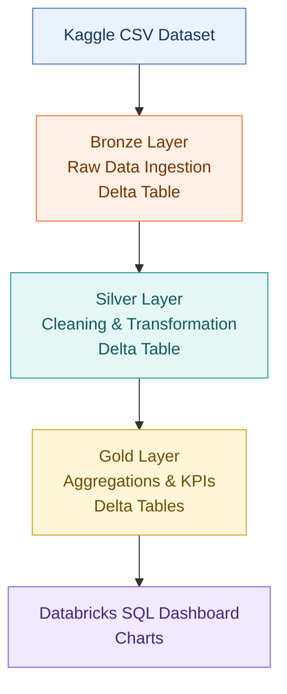

#  E-Commerce Sales Data Pipeline

##  Project Overview

An end-to-end ELT data pipeline built using **Databricks Community Edition, PySpark, and Delta Lake** to process over 30,000 e-commerce sales records.
The project follows the **Medallion Architecture (Bronze → Silver → Gold)** to transform raw data into clean, structured, and analytics-ready datasets. The workflow is orchestrated using Databricks Jobs, with task dependencies and automated email notifications.

## 🏗️Architecture

##  Gold Layer Analytics

The Gold layer provides four datasets for analyzing:

| Analytical Table | Purpose |
|---|---|
| Monthly Revenue | Track revenue trends over time |
| Product Sales | Analyze product-level sales performance |
| City Performance | Compare sales performance across cities |
| Hourly Sales | Identify sales patterns by hour |

##  Tech Stack

- **Databricks Community Edition** — Development and execution environment
- **Apache PySpark** — Data processing and transformation
- **Delta Lake** — Storage for processed data
- **Python** — Pipeline development
- **Databricks Jobs** — Workflow orchestration
- **Databricks SQL** — Queries and dashboard visualization

##  How to Run

1. Download the source dataset from Kaggle.
2. Upload the dataset and notebooks to Databricks Community Edition.
3. Run the Bronze notebook to ingest the raw data.
4. Run the Silver notebook to clean and transform the data.
5. Run the Gold notebook to generate analytical tables.
6. Query the Gold tables and build the dashboard in Databricks SQL.
7. Configure Databricks Jobs to orchestrate the workflow and notifications.

##  Key Learnings

- Building multi-layer data pipelines using the Medallion Architecture.
- Processing and transforming data with PySpark.
- Working with Delta Lake tables.
- Creating analytical datasets for business intelligence.
- Orchestrating dependent pipeline tasks in Databricks.

